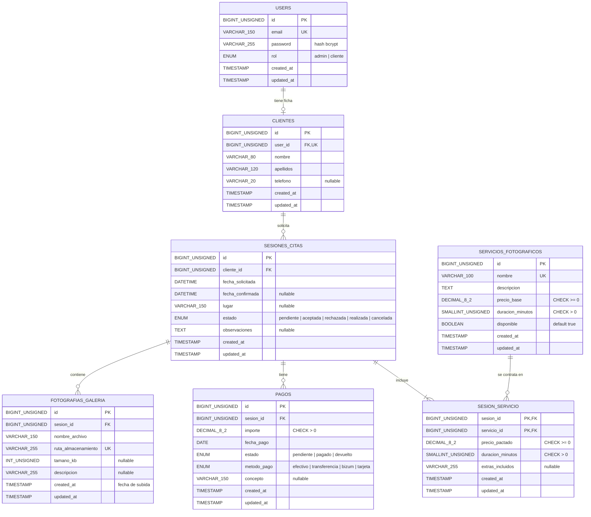

# Modelo entidad-relación de FotoGest Pro

## 1. Descripción

El modelo de datos de FotoGest Pro gestiona los clientes, el catálogo de servicios fotográficos, las sesiones, los pagos y las fotografías de las galerías privadas. Está normalizado en tercera forma normal (3FN) y se implementa en MySQL mediante migraciones de Laravel (`backend/database/migrations`).

El modelo tiene **cinco entidades de negocio** (`clientes`, `servicios_fotograficos`, `sesiones_citas`, `pagos` y `fotografias_galeria`), una **tabla intermedia con atributos propios** (`sesion_servicio`) y una **tabla técnica de autenticación** (`users`), que no computa como entidad de negocio.

## 2. Diagrama entidad-relación

## 3. Relaciones y cardinalidades

| Relación | Tipo | Descripción | Borrado (ON DELETE) |
|---|---|---|---|
| `users` — `clientes` | 1:1 (0..1) | Cada cuenta con rol cliente tiene una ficha de cliente. La cuenta de la administradora no tiene ficha. | CASCADE: la ficha no existe sin su cuenta. |
| `clientes` — `sesiones_citas` | 1:N | Un cliente solicita cero o varias sesiones; cada sesión pertenece a un único cliente. | RESTRICT: un cliente con sesiones no se borra, para conservar el historial. |
| `sesiones_citas` — `servicios_fotograficos` | M:N | Una sesión incluye uno o varios servicios y un servicio forma parte de varias sesiones. Se resuelve con `sesion_servicio`. | — |
| `sesiones_citas` — `sesion_servicio` | 1:N | Líneas de servicio de cada sesión. | CASCADE: la línea no tiene sentido sin su sesión. |
| `servicios_fotograficos` — `sesion_servicio` | 1:N | Sesiones en las que se ha contratado el servicio. | RESTRICT: un servicio ya contratado no se borra; se desactiva (`disponible = false`). |
| `sesiones_citas` — `pagos` | 1:N | Una sesión tiene cero o varios pagos (señal, pago final…). | RESTRICT: un registro económico no se elimina en cascada. |
| `sesiones_citas` — `fotografias_galeria` | 1:N | Una sesión tiene cero o varias fotografías. | CASCADE: las fotografías pertenecen a la sesión. |

## 4. Tabla intermedia con atributos propios

`sesion_servicio` tiene clave primaria compuesta (`sesion_id`, `servicio_id`) y guarda las condiciones acordadas para cada servicio dentro de una sesión:

- `precio_pactado`: precio acordado con el cliente. Al crear la sesión se copia de `precio_base`, pero después es independiente del catálogo.
- `duracion_minutos`: duración acordada para ese servicio en esa sesión.
- `extras_incluidos`: extras negociados (por ejemplo, fotos impresas).

Si la fotógrafa cambia la tarifa de un servicio en el catálogo, las sesiones ya contratadas conservan su precio.

## 5. Justificación de la tercera forma normal (3FN)

1. **1FN:** todos los atributos son atómicos. Los servicios de una sesión se representan como filas de `sesion_servicio` y las fotografías como filas de `fotografias_galeria`, no como listas dentro de una columna.
2. **2FN:** la única clave compuesta está en `sesion_servicio`. Sus atributos (`precio_pactado`, `duracion_minutos`, `extras_incluidos`) dependen de la combinación completa sesión + servicio. El nombre o la descripción del servicio dependen solo de `servicio_id` y por eso permanecen en `servicios_fotograficos`.
3. **3FN:** no hay dependencias transitivas entre atributos no clave. El email y la contraseña se almacenan solo en `users`; `clientes` guarda únicamente datos personales y se enlaza con `user_id`. Los datos del cliente no se repiten en `sesiones_citas` ni en `pagos`, que acceden a ellos mediante claves foráneas. El total de una sesión no se almacena porque se calcula a partir de sus líneas.

## 6. Seguridad y almacenamiento

- La contraseña se almacena como hash bcrypt (coste 12) y el modelo `User` la oculta en todas las respuestas JSON.
- Los archivos de las fotografías se guardan en el disco privado de Laravel (`storage/app/private`), sin acceso público por URL. La API solo permite descargarlos a la administradora o al cliente propietario de la sesión. En el Hito 3, este almacenamiento se sustituye por Cloudinary.
