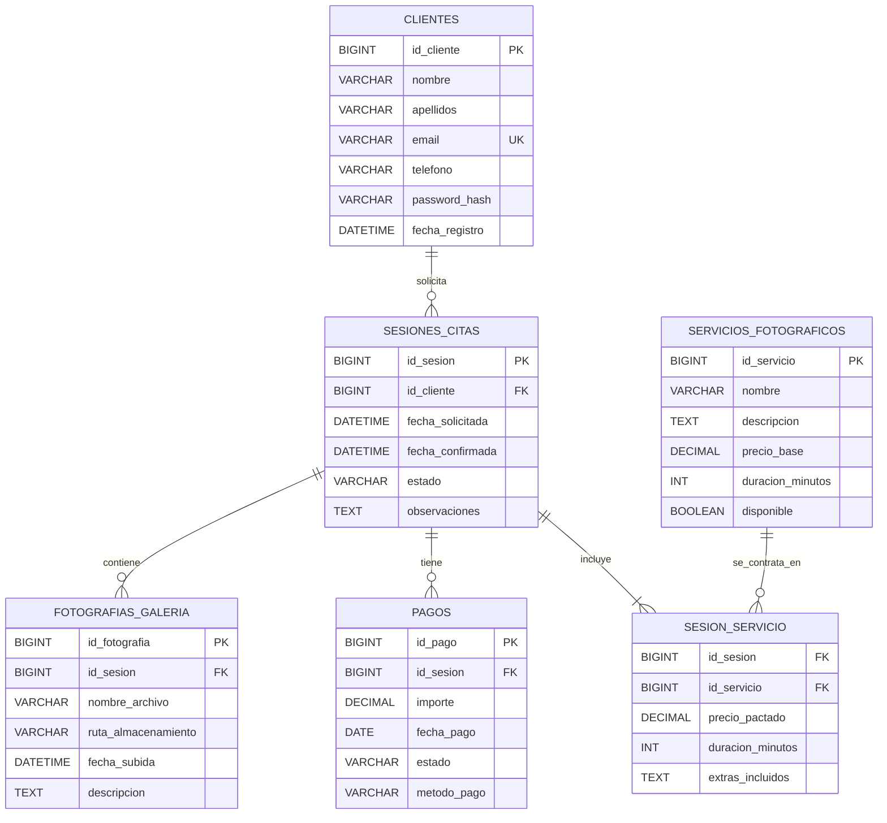

# Modelo entidad-relación de FotoGest Pro

## 1. Descripción

El modelo de datos de FotoGest Pro permite gestionar los clientes, el catálogo de servicios fotográficos, las sesiones, los pagos y las fotografías de las galerías privadas.

El diseño se organiza en entidades relacionadas entre sí para evitar duplicidades y mantener la integridad de la información.

## 2. Diagrama entidad-relación

## 3. Entidades y atributos

### Clientes

Almacena los datos de los clientes registrados. El correo electrónico será único para evitar registros duplicados. La contraseña se almacenará mediante un hash, nunca en texto plano.

- **PK:** `id_cliente`.
- **UK:** `email`.

### Servicios fotográficos

Contiene el catálogo de servicios que ofrece la fotógrafa, con su descripción, precio base, duración y disponibilidad.

- **PK:** `id_servicio`.

### Sesiones y citas

Registra las solicitudes de sesiones, la fecha solicitada, la fecha confirmada cuando corresponda, su estado y las observaciones.

- **PK:** `id_sesion`.
- **FK:** `id_cliente` referencia a `CLIENTES(id_cliente)`.

### Sesión-servicio

Resuelve la relación muchos a muchos entre sesiones y servicios. Permite contratar varios servicios en una misma sesión y que un servicio se utilice en distintas sesiones.

- **PK compuesta:** (`id_sesion`, `id_servicio`).
- **FK:** `id_sesion` referencia a `SESIONES_CITAS(id_sesion)`.
- **FK:** `id_servicio` referencia a `SERVICIOS_FOTOGRAFICOS(id_servicio)`.

Los atributos `precio_pactado`, `duracion_minutos` y `extras_incluidos` corresponden a las condiciones acordadas para cada servicio dentro de una sesión.

### Pagos

Registra los pagos relacionados con las sesiones, incluyendo importe, fecha, estado y método de pago.

- **PK:** `id_pago`.
- **FK:** `id_sesion` referencia a `SESIONES_CITAS(id_sesion)`.

### Fotografías de galería

Guarda los metadatos de las fotografías asociadas a cada sesión. Los archivos de imagen se almacenarán en un servicio externo y en la base de datos se guardará su ruta o identificador de almacenamiento.

- **PK:** `id_fotografia`.
- **FK:** `id_sesion` referencia a `SESIONES_CITAS(id_sesion)`.

## 4. Relaciones y cardinalidades

- **Clientes — Sesiones:** un cliente puede solicitar ninguna o varias sesiones; cada sesión pertenece a un único cliente. Relación 1:N.
- **Sesiones — Servicios:** una sesión puede incluir uno o varios servicios, y un servicio puede formar parte de varias sesiones. Relación N:M resuelta mediante `SESION_SERVICIO`.
- **Sesiones — Pagos:** una sesión puede tener ninguno o varios pagos; cada pago pertenece a una única sesión. Relación 1:N.
- **Sesiones — Fotografías:** una sesión puede tener ninguna o varias fotografías; cada fotografía pertenece a una única sesión. Relación 1:N.

## 5. Justificación de la tercera forma normal (3FN)

El modelo se plantea para cumplir la tercera forma normal:

1. **Primera forma normal (1FN):** cada atributo contiene un valor individual y no se almacenan listas de servicios o fotografías en una única columna.
2. **Segunda forma normal (2FN):** en `SESION_SERVICIO`, los atributos propios de la contratación dependen de la clave compuesta completa (`id_sesion`, `id_servicio`), y no solo de una parte de ella.
3. **Tercera forma normal (3FN):** los datos propios de clientes, servicios, sesiones, pagos y fotografías se guardan en sus entidades correspondientes. Se evitan dependencias transitivas entre atributos no clave.

El precio y la duración pactados se guardan en `SESION_SERVICIO` para conservar las condiciones acordadas aunque posteriormente cambien los datos generales del catálogo.

## 6. Consideraciones de seguridad y almacenamiento

Las contraseñas se almacenarán mediante hashes seguros. El acceso a las sesiones, pagos y galerías deberá comprobar la identidad y los permisos del usuario.

Las fotografías se guardarán en un servicio de almacenamiento externo, como Amazon S3 o Cloudinary. El acceso a las imágenes privadas deberá estar protegido; conocer una ruta o URL no debe permitir el acceso público sin autorización.

Este documento define el diseño lógico inicial. La implementación física, las migraciones y las restricciones concretas se realizarán en fases posteriores del proyecto.
